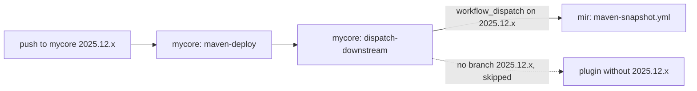

# dispatch-downstream.yml

Starts the snapshot deploy of dependent repositories right after a snapshot deploy, so their snapshots and
Docker images contain the new artifacts. When `mycore` deploys a new snapshot of `2025.12.x`, `mir` is rebuilt
on `2025.12.x` minutes later, instead of picking the change up with its next own push.

## Usage

The upstream project calls it after its deploy, in the same file as [`maven-deploy.yml`](maven-deploy.md):

```yaml
name: Maven Snapshot Deploy

on:
  push:
    branches:
      - main
      - '[0-9][0-9][0-9][0-9].[0-9][0-9].x'
  workflow_dispatch:

permissions:
  contents: read

jobs:
  deploy:
    concurrency:
      group: snapshot-deploy-${{ github.repository }}-${{ github.ref_name }}
      cancel-in-progress: true
    uses: MyCoRe-Org/github-workflows/.github/workflows/maven-deploy.yml@v1
    with:
      java-version: '25'
    secrets:
      MAVEN_USERNAME: ${{ secrets.MAVEN_USERNAME }}
      MAVEN_PASSWORD: ${{ secrets.MAVEN_PASSWORD }}

  downstream:
    needs: deploy
    if: github.event_name == 'push'
    uses: MyCoRe-Org/github-workflows/.github/workflows/dispatch-downstream.yml@v1
    with:
      targets: |
        MyCoRe-Org/mir maven-snapshot.yml
    secrets:
      DISPATCH_TOKEN: ${{ secrets.DISPATCH_TOKEN }}
```

The dependents need no change for this beyond what [`maven-deploy.yml`](maven-deploy.md) asks for anyway,
see [Requirements for targets](#requirements-for-targets).

## Inputs

| Input     | Required | Default                   | Description                                   |
|-----------|----------|---------------------------|-----------------------------------------------|
| `targets` | yes      |                           | Targets, one per line                         |
| `branch`  | no       | branch of the calling run | Branch for targets without an explicit branch |

| Secret           | Description                                |
|------------------|--------------------------------------------|
| `DISPATCH_TOKEN` | Token with `actions: write` on the targets |

## Targets

One target per line as `<owner/repository> <workflow> [<branch or pattern>]`:

```
# <owner/repository> <workflow> [<branch or pattern>]
MyCoRe-Org/mir maven-snapshot.yml
MyCoRe-Org/<repository> maven-snapshot.yml main
```

- `<workflow>` is the file name of the deploy workflow in `.github/workflows` of the target.
- Without `<branch>`, the target is built on the branch that was pushed upstream, so `2025.12.x` follows `2025.12.x`.
  Set a branch only for a dependent that always builds the same branch, whichever upstream branch was pushed.
- Instead of a branch, a shell pattern like `[0-9][0-9][0-9][0-9].[0-9][0-9].x` stands for all branches matching it
  that contain the workflow file, the other matching branches are skipped. Git does not allow `*`, `?` and `[`
  in branch names, so a pattern cannot be confused with a branch. Never use `*` alone: feature branches created
  from `main` contain the workflow as well, and their deploy would overwrite the snapshot of `main`.
- Empty lines and lines starting with `#` are ignored, Windows line endings do no harm.

## How it works



The job runs the action [`workflow-dispatch`](../.github/actions/workflow-dispatch/action.yml) with `DISPATCH_TOKEN`.
For every target it

1. checks that the token can read the repository, otherwise it reports an error and continues with the next target,
2. checks that the branch exists in the target. A missing branch is a notice, not an error,
   as not every dependent has every version branch. The [snapshot refresh](snapshot-refresh.md#targets) reports it
   as an error. A pattern is resolved to the matching branches that contain the workflow file,
3. starts the workflow on that branch with `workflow_dispatch`, like the "Run workflow" button would,
   and logs the link to the started run.

All targets are tried, the job fails at the end if any of them reported an error. The job summary lists the
started runs with their links. They appear in the Actions tab of the targets with the event `workflow_dispatch`
and the account of the token as actor.

This workflow does not wait for the started runs. The [snapshot refresh](snapshot-refresh.md) does,
it uses the same action with `wait: 'true'`. The action waits at most `wait-minutes`, by default 300 minutes,
runs not finished by then count as failed. That ends the job before the limit of 360 minutes of GitHub,
which would cancel it without a failure to report.

## Requirements for targets

- The deploy workflow has the trigger `workflow_dispatch`.
- The workflow file exists on the default branch of the target, GitHub only accepts dispatches for those,
  and on the dispatched branch, as GitHub runs the file as it is on that branch, with that branch's Java version.
- A `concurrency` group per branch with `cancel-in-progress`, as in the example. A series of upstream pushes then
  leads to one build of the target instead of a queue.
- `DISPATCH_TOKEN` covers the repository.

## One level deep

Only pushes dispatch, see `if: github.event_name == 'push'` in the example. Runs started by a dispatch, by hand or by
the weekly [snapshot refresh](snapshot-refresh.md) do not dispatch further. Without that condition

- the snapshot refresh, which dispatches every target directly, would also start the dependents of every target,
  so they would build twice,
- dispatches would chain through the whole dependency tree, and a dependency cycle would never stop.

A project that depends on the upstream only through a dependent, e.g. a plugin of `mir`, is listed in the
targets of the upstream as well, if it should be rebuilt on upstream pushes.

## Token

`DISPATCH_TOKEN` is an organization secret holding a fine-grained personal access token, e.g. of a bot account,
with resource owner MyCoRe-Org and the repository permission "Actions: Read and write" on all targets.
It starts the runs and reads their results. Patterns also read the branches and the workflow file, which needs
"Contents: Read" for private repositories, public ones are readable anyway.
`GITHUB_TOKEN` does not work, it is only valid for the repository of the run.

- The token may start every workflow with `workflow_dispatch` in its targets, releases included, and cancel runs or
  delete their logs. Set the organization variable `DISPATCH_ACTOR` to the login of its account:
  [`maven-release.yml`](maven-release.md#who-may-release) and [`maven-version-branch.yml`](maven-version-branch.md)
  refuse runs it starts or re-runs.
- Fine-grained tokens expire. Renew the token in time, an expired token makes every target fail with "cannot access".
- The organization must allow fine-grained tokens, and may require approving them.
- A GitHub App would need a step creating its installation token in the job. The workflows take the token as
  a secret and have no such step.

## Messages

| Message                                                                                                       | Meaning                                                                                                                                             |
|---------------------------------------------------------------------------------------------------------------|-----------------------------------------------------------------------------------------------------------------------------------------------------|
| `dispatched <workflow> in <repository>@<branch> <link>`                                                       | The run was started                                                                                                                                 |
| notice `<repository> has no branch <branch>, skipped`                                                         | Expected for dependents without that version branch. An error in the snapshot refresh                                                               |
| `<repository>@<branch> has no <workflow>, skipped`                                                            | The branch matches the pattern but has no deploy workflow, e.g. an old version branch                                                               |
| notice `no branch of <repository> matching <pattern> has <workflow>, skipped`                                 | Nothing to deploy for that line: a typo in the pattern, or the project does not have the workflow yet. An error in the snapshot refresh             |
| error `the token is empty, check that DISPATCH_TOKEN is shared with <repository> and passed on by the caller` | The organization secret is not shared with the calling repository, or the caller does not pass it                                                   |
| error `cannot access <repository>: …`                                                                         | Wrong repository name, or the token cannot read it: expired, or the repository is not selected for the token                                        |
| error `cannot check <repository>@<branch>: …`                                                                 | The branch check failed for another reason than a missing branch, e.g. a GitHub outage                                                              |
| error `cannot list the branches of <repository>: …`, `cannot check <workflow> in <repository>@<branch>: …`    | Resolving a pattern failed, e.g. because of a GitHub outage                                                                                         |
| error `dispatch of <workflow> in <repository>@<branch> failed: …`                                             | Wrong file name, no `workflow_dispatch` trigger, the file is missing on the default or on that branch, or the token lacks "Actions: Read and write" |

When waiting for the runs, as the snapshot refresh does:

| Message                                                                                     | Meaning                                                                                                             |
|---------------------------------------------------------------------------------------------|---------------------------------------------------------------------------------------------------------------------|
| `<workflow> in <repository>@<branch> succeeded`                                             | The deploy succeeded                                                                                                |
| error `<workflow> in <repository>@<branch> ended with <conclusion>, <link>`                 | The deploy failed, the link leads to its log                                                                        |
| warning `<workflow> in <repository>@<branch> was cancelled, <link>`                         | Another run of the same concurrency group replaced it, e.g. after a push at the same time, that run deploys instead |
| warning `no run id returned for <workflow> in <repository>@<branch>, not waiting for it`    | GitHub did not return the run, its result is not checked                                                            |
| `cannot check <link> yet: …`                                                                | Reading the status failed, it is tried again in the next round                                                      |
| error `<workflow> in <repository>@<branch> did not finish within <minutes> minutes, <link>` | The run is still queued or running, or was deleted. It is not waited for any longer                                 |
