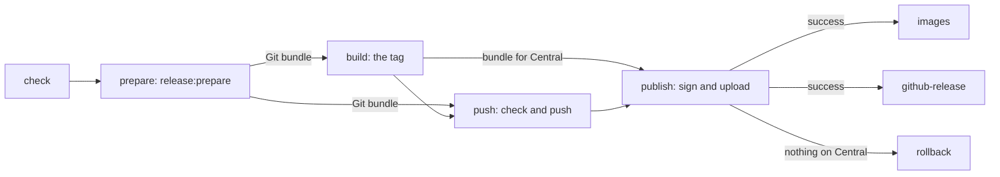

# maven-release.yml

Releases a Maven project with `release:prepare` of the `maven-release-plugin`: release version and tag, a build of the
tag, a signed upload to Sonatype Central, Docker images and GitHub release, with a rollback when nothing reached
Central. Code of the project only runs in jobs without secrets. A maintainer starts it by hand.

## Usage

```yaml
name: Maven Release

on:
  workflow_dispatch:
    inputs:
      mycoreVersion:
        description: 'MyCoRe version for the release (e.g. 2026.06.2)'
        required: true
      mycoreDevelopmentVersion:
        description: 'MyCoRe version for the next development iteration (e.g. 2026.06.3-SNAPSHOT)'
        required: true
      releaseVersion:
        description: 'Release version (empty for Maven default)'
        required: false
      developmentVersion:
        description: 'Next development version (empty for Maven default)'
        required: false

concurrency:
  group: maven-release-${{ github.ref }}
  cancel-in-progress: false

permissions:
  contents: write

jobs:
  release:
    uses: MyCoRe-Org/github-workflows/.github/workflows/maven-release.yml@v1
    with:
      java-version: '25'
      release-version: ${{ inputs.releaseVersion }}
      development-version: ${{ inputs.developmentVersion }}
      dependency-version: ${{ inputs.mycoreVersion }}
      dependency-development-version: ${{ inputs.mycoreDevelopmentVersion }}
      dependency-artifact: org.mycore:mycore-base
    secrets:
      MAVEN_USERNAME: ${{ secrets.MAVEN_USERNAME }}
      MAVEN_PASSWORD: ${{ secrets.MAVEN_PASSWORD }}
      MAVEN_GPG_PRIVATE_KEY: ${{ secrets.MAVEN_GPG_PRIVATE_KEY }}
      MAVEN_GPG_PASSPHRASE: ${{ secrets.MAVEN_GPG_PASSPHRASE }}
      RELEASE_APP_PRIVATE_KEY: ${{ secrets.RELEASE_APP_PRIVATE_KEY }}
      MATRIX_ACCESS_TOKEN: ${{ secrets.MATRIX_ACCESS_TOKEN }}
```

The caller passes the secrets on by name, their values come from the environment `release`,
see [Secrets and push access](#secrets-and-push-access).

To release, open the workflow in the Actions tab, choose the branch and fill in the versions.
The job `push` uses the concurrency group `maven-release-job-<repository>-<ref>` itself,
a group of the caller must have a different name, equal names deadlock.

Other project specific steps run in the caller after the release, using the `version` output.

## Before the first release

- `mycore-parent` 57 or newer, so the version branches since `2023.06.x` release as well. Its `git` profile configures
  the release plugin with the tag format `v@{project.version}` and `release-profile` attaches sources and javadoc.
  The build switches `deploy-to-central` off and deploys with the `maven-deploy-plugin` of the parent into a
  directory, independent of the version of the `central-publishing-maven-plugin` the parent brings. From 0.12.0 on,
  that plugin could create the bundle itself with `-DskipUpload=true`, but the parents 57 to 59 of the branches since
  2023 bring 0.7.0 to 0.10.0.
- An own `<scm>` section in the root `pom.xml` with `connection`, `developerConnection` and `url` of the repository.
  An inherited one points to the repository of the parent.
- The [environment `release`](../README.md#the-environment-release) with the Central token and the signing key.
- The [GitHub App](../README.md#push-access) if the branch is protected.
- Protected release tags, see [Release tags](#release-tags).

## Inputs

| Input                            | Required        | Default                                      | Description                                                                                                                     |
|----------------------------------|-----------------|----------------------------------------------|---------------------------------------------------------------------------------------------------------------------------------|
| `java-version`                   | yes             |                                              | Java version, e.g. `'25'`                                                                                                       |
| `release-version`                | no              | Maven default                                | Release version                                                                                                                 |
| `development-version`            | no              | Maven default                                | Next development version                                                                                                        |
| `dependency-property`            | no              | `mycore.version`                             | Property pinned for the release, empty to skip (e.g. for `mycore` itself)                                                       |
| `dependency-version`             | if property set |                                              | Release value of the property, must not be a snapshot                                                                           |
| `dependency-development-version` | no              | previous value                               | Value of the property after the release                                                                                         |
| `dependency-artifact`            | no              |                                              | `groupId:artifactId` checked on Maven Central for `dependency-version` before the release starts, e.g. `org.mycore:mycore-base` |
| `prepare-args`                   | no              |                                              | Arguments passed to the build of `release:prepare`, e.g. profiles or `-DskipTests`                                              |
| `build-args`                     | no              | `-Prelease-profile -DskipTests`              | Arguments of the build of the tag, which creates the bundle for Central, see [Examples](#examples)                              |
| `maven-opts`                     | no              |                                              | `MAVEN_OPTS` of prepare and build, e.g. `-Xss128M`                                                                              |
| `group-id-prefix`                | no              | `org.mycore`                                 | groupId every published file must have, or start with followed by a dot                                                         |
| `release-notes-file`             | no              |                                              | File in the repository appended to the release notes, `@VERSION@` is replaced                                                   |
| `release-assets`                 | no              | jars and wars of the root and of each module | Glob patterns of files attached to the GitHub release, one per line, empty to attach none                                       |
| `docker-images`                  | no              |                                              | Images to push, see [Docker images](#docker-images)                                                                             |
| `setup-browser`                  | no              | `false`                                      | See [`maven-build.yml`](maven-build.md)                                                                                         |
| `project-setup`                  | no              | `false`                                      | See [`maven-build.yml`](maven-build.md#project-setup)                                                                           |
| `environment`                    | no              | `release`                                    | Environment of the jobs with secrets, holds the release secrets, must not be empty                                              |

| Secret                                           | Description                                                                    |
|--------------------------------------------------|--------------------------------------------------------------------------------|
| `MAVEN_USERNAME` / `MAVEN_PASSWORD`              | Sonatype Central token                                                         |
| `MAVEN_GPG_PRIVATE_KEY` / `MAVEN_GPG_PASSPHRASE` | Signing key                                                                    |
| `DOCKERHUB_USERNAME` / `DOCKERHUB_TOKEN`         | Docker Hub login, needed with `docker-images`                                  |
| `RELEASE_APP_PRIVATE_KEY`                        | Private key of the GitHub App that pushes, needed with `RELEASE_APP_CLIENT_ID` |
| `MATRIX_ACCESS_TOKEN`                            | Optional, see [notifications](../README.md#notifications)                      |

| Variable                | Description                                                                                 |
|-------------------------|---------------------------------------------------------------------------------------------|
| `RELEASE_APP_CLIENT_ID` | Client ID of the GitHub App that pushes, see [Push access](../README.md#push-access)        |
| `DISPATCH_ACTOR`        | Account of `DISPATCH_TOKEN`, which may not release, see [Who may release](#who-may-release) |

| Output    | Description                                                                                         |
|-----------|-----------------------------------------------------------------------------------------------------|
| `version` | Released version without the `v` prefix, as push checked and pushed it, empty if nothing was pushed |

## How it works



| Job              | Secrets                    | Code of the project | Does                                                      |
|------------------|----------------------------|---------------------|-----------------------------------------------------------|
| `check`          | only whether they are set  | no                  | Checks trigger, secrets and inputs                        |
| `prepare`        | none                       | yes                 | Pins, `release:prepare` with the tests, Git bundle        |
| `build`          | none                       | yes                 | Builds the tag: bundle for Central, assets, Docker images |
| `push`           | key of the GitHub App      | no                  | Checks the Git bundle, pushes branch and tag              |
| `publish`        | signing key, Central token | no                  | Checks and signs the bundle, uploads it to Central        |
| `images`         | Docker Hub login           | no                  | Pushes the images of build                                |
| `github-release` | `GITHUB_TOKEN`             | no                  | Creates the GitHub release                                |
| `rollback`       | key of the GitHub App      | no                  | Reverts the release commits and deletes the tag           |
| `notify`         | `MATRIX_ACCESS_TOKEN`      | no                  | Reports to Matrix                                         |

1. **check** stops the run before anything is built. The run must start on a branch, not on a tag, and not by the
   account of `DISPATCH_TOKEN`, see [Who may release](#who-may-release). The Central token and the signing key must
   be set, the Docker Hub login with `docker-images` and the key of the GitHub App with `RELEASE_APP_CLIENT_ID`,
   otherwise the run would only fail in publish, after the push. Versions must not contain whitespace,
   `release-version` must not start with `v` or end with `-SNAPSHOT`, and `dependency-version` is required with
   `dependency-property` and must not be a snapshot. With `dependency-artifact`, the workflow stops if that version
   is not on Maven Central yet, e.g. when the MyCoRe release is still being published.
2. **prepare** runs without secrets.
   1. **Pin.** In the root `pom.xml`, the property `dependency-property` gets `dependency-version` and the `<url>`
      in `<scm>` gets `https://github.com/<repository>/tree/v<version>`. The released pom then points to its sources.
      The change is committed as "Pin dependency version and scm.url for the release".
   2. **`release:prepare`** sets the release version, builds with `clean install` and `prepare-args`, including the
      tests, commits "[maven-release-plugin] prepare release v&lt;version&gt;", tags `v<version>`, sets the next
      development version and commits "[maven-release-plugin] prepare for next development iteration".
   3. **Restore.** The property gets `dependency-development-version`, or its previous value, and the scm url its
      previous value. Both are folded into the development commit, so after the release the pom differs from before
      only in the version, and in the property if a development value was given.
   4. **Bundle.** Commits and tag go into a Git bundle, which the job uploads as artifact for one day.
3. **build** runs without secrets as well. It checks out the tag from the bundle and builds it with
   `mvn deploy -DskipDeployToCentral` and `build-args`, which deploys into a directory instead of uploading. That
   directory without the `maven-metadata.xml` files, which Central creates itself, is the unsigned bundle for
   Central. Modules with `maven.deploy.skip` are left out, as with every deploy. The job also collects the release
   assets and builds the Docker images. Its result is only published after push has checked the commits it was
   built from.
4. **push** checks the Git bundle before anything is pushed:
   - It builds on the commit of the run: the pin commit, if anything was pinned, the release commit with the tag
     and the development commit, without merges.
   - Only `pom.xml` files change, and in them only values. The pin commit sets the scm url and the property, the
     release commit also `<version>` to the release version and `<tag>` to `v<version>`, the development commit
     `<version>` to the development version, `<tag>` to `HEAD` and the property to `dependency-development-version`.
   - The versions match `release-version` and `development-version`, if given.

   Then branch and tag are pushed in one atomic push, with a token of the GitHub App created right before.
   If someone pushed to the branch in the meantime, nothing is pushed and the run fails.
5. **publish** first checks that the tag is still the pushed one. Every file of the bundle must belong to a component
   under `group-id-prefix` in the release version, without signatures of its own and without links. publish signs
   every file but the checksums, adds checksums of the signatures, uploads the bundle with the publisher API of
   Central for automatic publishing and waits up to 30 minutes until Central has validated it.
6. **images** and **github-release** run after a successful publish, independently of each other. images pushes the
   images of build, tagged with the version. github-release creates the GitHub release `v<version>` with the notes
   GitHub generates since the previous `v*` tag, the [notes file](#release-notes-and-assets) and the assets.
7. **rollback** runs if publish failed or was cancelled before the upload, or if Central refused the upload. It
   reverts the release commits in one commit "Roll back the release of v&lt;version&gt;", pushes it and deletes the
   tag in one atomic push. The poms are the ones of before the release, commits pushed since the release stay.
8. **notify** reports to Matrix, if configured: released, released but Docker images or GitHub release failed,
   failed before anything was pushed, rolled back, uploaded with an unknown result, or rollback incomplete.

The commits are made in the name of the user who started the run, with the noreply address that links them to the
account.

## When something fails

| Failing job                                                         | State afterwards                                                              | What to do                                                                                  |
|---------------------------------------------------------------------|-------------------------------------------------------------------------------|---------------------------------------------------------------------------------------------|
| `check`, `prepare` or `build`                                       | Nothing pushed                                                                | Fix the cause, start a new run                                                              |
| `push`                                                              | Nothing pushed, also when only the tag was rejected or the bundle was refused | Check the GitHub App and the rulesets, or the log of prepare for a refused bundle           |
| `publish` before the upload, or Central refused it                  | Rolled back: the release commits are reverted, the tag is deleted             | Fix the cause, the version can be released again                                            |
| `publish` after the upload, e.g. cancelled or not validated in time | Tag and commits stay, the deployment may still be published                   | Re-run the failed jobs: publish waits for the same deployment, then continues or rolls back |
| `images`                                                            | Released, the GitHub release is created anyway                                | Re-run the failed jobs or push the images by hand                                           |
| `github-release`                                                    | Released                                                                      | Re-run the failed jobs or create the release by hand                                        |
| `rollback`                                                          | Tag and commits stay, nothing is on Central                                   | Revert the release commits and delete the tag by hand                                       |

"Re-run failed jobs" continues a run with the artifacts of prepare and build, which are kept for a day:
- After a failing push, e.g. because of the GitHub App, as long as nobody pushed to the branch in the meantime.
- After publish failed once the bundle was uploaded. publish keeps the id of the deployment as artifact and, run again,
  waits for that deployment instead of uploading the version a second time, which Central would refuse.
- After a failing images or github-release job.
- Not after a rollback: publish then refuses to run, as the tag is gone. Start a new run.

## Secrets and push access

The jobs with secrets, check, push, publish, images and rollback, run in the environment `environment` of the calling
repository, `release` by default. Only publish creates a deployment of the environment, the others use it with
`deployment: false`. The release secrets belong in that environment, not in organization secrets shared with the
repository: only jobs on its deployment branches get them, see
[The environment `release`](../README.md#the-environment-release). The caller passes them on by name all the same,
as in the usage example. Environment secrets take precedence over organization secrets of the same name.

Branch and tag are pushed with a token of the [GitHub App](../README.md#push-access), created right before the push
and before the push of a rollback. Without `RELEASE_APP_CLIENT_ID` the workflow pushes with `GITHUB_TOKEN`. That fails
on protected branches, and pushes with `GITHUB_TOKEN` start no workflows: neither the snapshot deploy of the next
development version nor the [forward merge](forward-merge.md) would run after a release.

Code of the project, the tests, the Maven plugins and the npm packages of frontend builds, only runs in prepare and
build. These get no secret and run outside the environment. The jobs with secrets run only Git, GPG, curl and Docker,
and check what they get from prepare and build: push the commits, publish the files of the bundle. Code in the build
can still change the artifacts it builds, which are then signed and published, but it cannot read a secret or get
other files signed.

build and the jobs with secrets use no cache (`cache-mode: none`), prepare only reads it, as push checks its result.
Every release downloads the dependencies of its build anew.

## Who may release

Everybody who may run workflows on a deployment branch of the environment can release. Required reviewers of the
environment would ask for an approval for every job that uses the environment.

Runs started or re-run by the account of `DISPATCH_TOKEN` are refused. That token may start every workflow with
`workflow_dispatch` in its targets, so whoever can read it could start releases otherwise. Set the organization
variable `DISPATCH_ACTOR` to the login of that account. Every job with secrets checks it again, as a job can be re-run
on its own.

## Release tags

The tags `v*` of the repository should only change through this workflow:

- A tag ruleset for `v*` restricting creations, updates and deletions, with the GitHub App as bypass actor.
  The rollback deletes the tag, so the App needs the bypass for deletions as well.
- Immutable releases in the settings of the repository. A published release then keeps its tag and its assets.
  `gh release create` uploads the assets to a draft and publishes it afterwards, as immutable releases require.

## Release notes and assets

`release-notes-file` is a file in the repository, appended to the generated notes, with `@VERSION@` replaced
by the version. It is the place for the Maven coordinates and download links:

````markdown
## Maven

```xml
<dependency>
  <groupId>org.mycore</groupId>
  <artifactId>mycore-base</artifactId>
  <version>@VERSION@</version>
</dependency>
```
````

`release-assets` attaches the jars and wars of the root project and of each module of the build of the tag by default.
Projects with many modules, like `mycore`, set it to `''`.

## Docker images

`docker-images` works as in [`maven-deploy.yml`](maven-deploy.md#docker-images), but build builds the images from the
checkout of the tag, without any credentials, and tags them with the version only. images pushes them once the
release has reached Central.

A switch in the form decides per release whether the images are built. With the switch off, every line is empty
and nothing is built or pushed:

```yaml
on:
  workflow_dispatch:
    inputs:
      # the inputs of the usage example, and
      dockerImages:
        description: 'Build and push the release Docker images'
        type: boolean
        default: true

jobs:
  release:
    uses: MyCoRe-Org/github-workflows/.github/workflows/maven-release.yml@v1
    with:
      # the inputs of the usage example, and
      docker-images: |
        ${{ inputs.dockerImages && 'mycoreorg/<app> . Dockerfile' || '' }}
        ${{ inputs.dockerImages && 'mycoreorg/<app>-solr <app>-webapp/src/main/solr/' || '' }}
    secrets:
      # the secrets of the usage example, and
      DOCKERHUB_USERNAME: ${{ secrets.DOCKERHUB_USERNAME }}
      DOCKERHUB_TOKEN: ${{ secrets.DOCKERHUB_TOKEN }}
```

## Examples

Release of a project with Selenium tests, without dependency property and without attached assets:

```yaml
    with:
      java-version: '25'
      dependency-property: ''
      release-assets: ''
      setup-browser: true
```

Release of `mir` on `2026.06.x`. Its module `mir-it` starts a servlet container even with `-DskipTests`, up to
`2026.06.x` only with `-Djetty` or `-Dtomcat`, as in the CI of the branch. On `main` Tomcat is the default.
The build of the tag needs it as well, and `build-args` replaces its default, so it keeps
`-Prelease-profile -DskipTests`:

```yaml
    with:
      java-version: '25'
      prepare-args: '-Dtomcat'
      build-args: '-Prelease-profile -DskipTests -Dtomcat'
```
