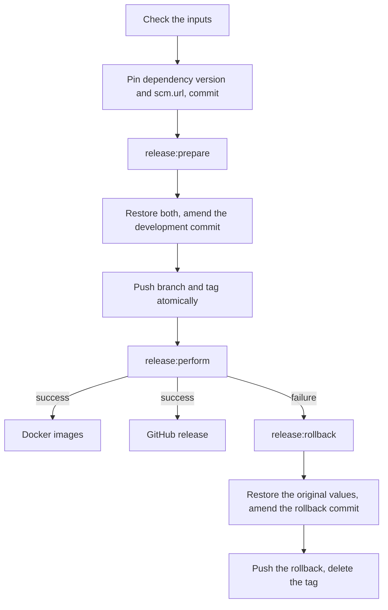

# maven-release.yml

Releases a Maven project with the `maven-release-plugin`: release version, tag, signed deploy to Sonatype Central,
Docker images and GitHub release, with a rollback when the deploy fails. A maintainer starts it by hand.

## Usage

```yaml
name: Maven Release

on:
  workflow_dispatch:
    inputs:
      mycoreVersion:
        description: 'MyCoRe version for the release (e.g. 2025.06.2)'
        required: true
      mycoreDevelopmentVersion:
        description: 'MyCoRe version for the next development iteration (e.g. 2025.06.3-SNAPSHOT)'
        required: true
      releaseVersion:
        description: 'Release version (empty for Maven default)'
        required: false
      developmentVersion:
        description: 'Next development version (empty for Maven default)'
        required: false

concurrency:
  group: maven-release-${{ github.ref }}
  cancel-in-progress: false

permissions:
  contents: write

jobs:
  release:
    uses: MyCoRe-Org/github-workflows/.github/workflows/maven-release.yml@v1
    with:
      java-version: '25'
      release-version: ${{ inputs.releaseVersion }}
      development-version: ${{ inputs.developmentVersion }}
      dependency-version: ${{ inputs.mycoreVersion }}
      dependency-development-version: ${{ inputs.mycoreDevelopmentVersion }}
      dependency-artifact: org.mycore:mycore-base
    secrets:
      MAVEN_USERNAME: ${{ secrets.MAVEN_USERNAME }}
      MAVEN_PASSWORD: ${{ secrets.MAVEN_PASSWORD }}
      MAVEN_GPG_PRIVATE_KEY: ${{ secrets.MAVEN_GPG_PRIVATE_KEY }}
      MAVEN_GPG_PASSPHRASE: ${{ secrets.MAVEN_GPG_PASSPHRASE }}
      RELEASE_TOKEN: ${{ secrets.RELEASE_TOKEN }}
      MATRIX_ACCESS_TOKEN: ${{ secrets.MATRIX_ACCESS_TOKEN }}
```

To release, open the workflow in the Actions tab, choose the branch and fill in the versions.
The release job uses the concurrency group `maven-release-job-<repository>-<ref>` itself,
a group of the caller must have a different name, equal names deadlock.

Other project specific steps run in the caller after the release, using the `version` output.

## Before the first release

- `mycore-parent` 57 or newer. Its `git` profile configures the release plugin with the tag format `v@{project.version}`,
  `release-profile` attaches sources and javadoc, `sign-artifacts` signs and `deploy-to-central` deploys.
- An own `<scm>` section in the root `pom.xml` with `connection`, `developerConnection` and `url` of the repository.
  An inherited one points to the repository of the parent.
- The [organization secrets](../README.md#secrets) for Central and the signing key, shared with the repository.
- `RELEASE_TOKEN` if the branch is protected, see [Tokens](#tokens).
- Optionally an environment `release` with deployment branch rules, see [Tokens](#tokens).

## Inputs

| Input                            | Required        | Default                                      | Description                                                                                                                     |
|----------------------------------|-----------------|----------------------------------------------|---------------------------------------------------------------------------------------------------------------------------------|
| `java-version`                   | yes             |                                              | Java version, e.g. `'25'`                                                                                                       |
| `release-version`                | no              | Maven default                                | Release version                                                                                                                 |
| `development-version`            | no              | Maven default                                | Next development version                                                                                                        |
| `dependency-property`            | no              | `mycore.version`                             | Property pinned for the release, empty to skip (e.g. for `mycore` itself)                                                       |
| `dependency-version`             | if property set |                                              | Release value of the property, must not be a snapshot                                                                           |
| `dependency-development-version` | no              | previous value                               | Value of the property after the release                                                                                         |
| `dependency-artifact`            | no              |                                              | `groupId:artifactId` checked on Maven Central for `dependency-version` before the release starts, e.g. `org.mycore:mycore-base` |
| `prepare-args`                   | no              |                                              | Arguments passed to the build of `release:prepare`, e.g. profiles or `-DskipTests`                                              |
| `perform-args`                   | no              | `-Psign-artifacts -DskipTests`               | Arguments passed to `release:perform`                                                                                           |
| `release-notes-file`             | no              |                                              | File in the repository appended to the release notes, `@VERSION@` is replaced                                                   |
| `release-assets`                 | no              | jars and wars of the root and of each module | Glob patterns of files attached to the GitHub release, one per line, empty to attach none                                       |
| `docker-images`                  | no              |                                              | Images to push, see [Docker images](#docker-images)                                                                             |
| `setup-browser`                  | no              | `false`                                      | See [`maven-build.yml`](maven-build.md)                                                                                         |
| `project-setup`                  | no              | `false`                                      | See [`maven-build.yml`](maven-build.md#project-setup)                                                                           |
| `environment`                    | no              | `release`                                    | Environment of the release job                                                                                                  |

| Secret                                           | Description                                                                  |
|--------------------------------------------------|------------------------------------------------------------------------------|
| `MAVEN_USERNAME` / `MAVEN_PASSWORD`              | Sonatype Central token                                                       |
| `MAVEN_GPG_PRIVATE_KEY` / `MAVEN_GPG_PASSPHRASE` | Signing key                                                                  |
| `DOCKERHUB_USERNAME` / `DOCKERHUB_TOKEN`         | Docker Hub login, needed with `docker-images`                                |
| `RELEASE_TOKEN`                                  | Optional, token that may push to the protected branch, see [Tokens](#tokens) |
| `MATRIX_ACCESS_TOKEN`                            | Optional, see [notifications](../README.md#notifications)                    |

| Output    | Description                             |
|-----------|-----------------------------------------|
| `version` | Released version without the `v` prefix |

## How it works



1. **Check the inputs.** Versions must not contain whitespace, `release-version` must not start with `v`
   or end with `-SNAPSHOT`, and `dependency-version` is required with `dependency-property` and must not be a snapshot.
   With `dependency-artifact`, the workflow stops if that version is not on Maven Central yet,
   e.g. when the MyCoRe release is still being published.
2. **Pin.** In the root `pom.xml`, the property `dependency-property` gets `dependency-version` and the `<url>`
   in `<scm>` gets `https://github.com/<repository>/tree/v<version>`. The released pom then points to its sources.
   The change is committed as "Pin dependency version and scm.url for the release".
3. **`release:prepare`** sets the release version, builds with `clean install` and `prepare-args`, including the tests,
   commits "[maven-release-plugin] prepare release v&lt;version&gt;", tags `v<version>`, sets the next development
   version and commits "[maven-release-plugin] prepare for next development iteration". Nothing is pushed yet.
4. **Restore.** The property gets `dependency-development-version`, or its previous value, and the scm url its
   previous value. Both are folded into the development commit, so after the release the pom differs from before
   only in the version, and in the property if a development value was given.
5. **Push.** Branch and tag are pushed in one atomic push. If someone pushed to the branch in the meantime,
   nothing is pushed and the run fails.
6. **`release:perform`** checks out the tag into `target/checkout`, builds it with `perform-args`, signs the artifacts
   and deploys them to Central, which publishes them after validation.
7. **Docker images** are built from `target/checkout` and tagged with the version.
8. **GitHub release** `v<version>` with the notes GitHub generates since the previous `v*` tag,
   the [notes file](#release-notes-and-assets) and the assets.

9. **Notification** to Matrix, if configured: released, released but Docker images or GitHub release failed,
   failed and rolled back, rolled back without restoring the dependency version and scm url,
   failed before anything was pushed, or failed with an incomplete rollback.

Steps 7 and 8 run after a successful `release:perform` independently of each other, a failing Docker push does not
prevent the GitHub release.

The commits are made in the name of the user who started the run, with the noreply address that links them to the
account.

## When something fails

| Failing step                          | State afterwards                                                                                                                                                                                                                                               | What to do                                                  |
|---------------------------------------|----------------------------------------------------------------------------------------------------------------------------------------------------------------------------------------------------------------------------------------------------------------|-------------------------------------------------------------|
| Input check, pin or `release:prepare` | Nothing pushed                                                                                                                                                                                                                                                 | Fix the cause, re-run the job or start a new run            |
| Push                                  | Nothing pushed, also when only the tag was rejected                                                                                                                                                                                                            | Check `RELEASE_TOKEN` and the branch rules, start a new run |
| `release:perform`                     | Rolled back: the plugin commits "[maven-release-plugin] rollback the release of v&lt;version&gt;", the workflow restores the original property and scm url into that commit, pushes it and deletes the tag. The pom is identical to the one before the release | See below                                                   |
| Docker images                         | Released, tag and Central artifacts exist, the GitHub release is created anyway                                                                                                                                                                                | Build and push the images by hand                           |
| GitHub release                        | Released, tag and Central artifacts exist                                                                                                                                                                                                                      | Create the release by hand from the tag                     |

If `release:perform` failed after the deployment had reached Central, the version number is taken for good,
the run warns about it. Release the next version number then.

A failed run can only be re-run if it failed before the push. After the push the branch has moved on,
a re-run starts again from the old commit and its push is rejected. Start a new run instead.

## Tokens

Without `RELEASE_TOKEN` the workflow pushes with `GITHUB_TOKEN`. That fails on protected branches, and pushes
with `GITHUB_TOKEN` start no workflows: neither the snapshot deploy of the next development version nor the
[forward merge](forward-merge.md) would run after a release. `RELEASE_TOKEN` is a token of an account that may push
to the branch, e.g. a bypass actor of the branch ruleset.

The job runs in the environment `environment` of the calling repository. Its deployment branch rules can restrict
releases to protected branches. That restricts the branches only, the organization secrets stay readable from
every branch, see [Secrets](../README.md#secrets). Keep no secrets in that environment, environment secrets take
precedence over the organization secrets passed by the caller.

## Release notes and assets

`release-notes-file` is a file in the repository, appended to the generated notes, with `@VERSION@` replaced
by the version. It is the place for the Maven coordinates and download links:

````markdown
## Maven

```xml
<dependency>
  <groupId>org.mycore</groupId>
  <artifactId>mycore-base</artifactId>
  <version>@VERSION@</version>
</dependency>
```
````

`release-assets` attaches the jars and wars of the root project and of each module by default.
Projects with many modules, like `mycore`, set it to `''`.

## Docker images

`docker-images` works as in [`maven-deploy.yml`](maven-deploy.md#docker-images), but the images are built
from `target/checkout`, where `release:perform` built the released artifacts, and tagged with the version only.

## Examples

Release of a project with Selenium tests, without dependency property and without attached assets:

```yaml
    with:
      java-version: '25'
      dependency-property: ''
      release-assets: ''
      setup-browser: true
```
