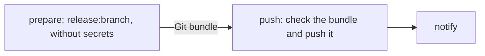

# maven-version-branch.yml

Creates a version branch like `2026.12.x` with the `release:branch` goal of the `maven-release-plugin`, and moves the
branch it starts from, usually `main`, to the next development version. A maintainer starts it by hand.

## Usage

```yaml
name: Maven Version Branch

on:
  workflow_dispatch:
    inputs:
      branch:
        description: 'Version branch to create from the chosen branch (e.g. 2026.12.x)'
        required: true
      developmentVersion:
        description: 'Version of the chosen branch afterwards (e.g. 2027.06.0-SNAPSHOT)'
        required: true
      mycoreDevelopmentVersion:
        description: 'MyCoRe version of the chosen branch afterwards (e.g. 2027.06.0-SNAPSHOT), empty to keep it'
        required: false

permissions:
  contents: write

jobs:
  branch:
    uses: MyCoRe-Org/github-workflows/.github/workflows/maven-version-branch.yml@v1
    with:
      java-version: '25'
      branch: ${{ inputs.branch }}
      development-version: ${{ inputs.developmentVersion }}
      dependency-development-version: ${{ inputs.mycoreDevelopmentVersion }}
    secrets:
      RELEASE_APP_PRIVATE_KEY: ${{ secrets.RELEASE_APP_PRIVATE_KEY }}
      MATRIX_ACCESS_TOKEN: ${{ secrets.MATRIX_ACCESS_TOKEN }}
```

To create a branch, open the workflow in the Actions tab, choose the branch to start from and fill in the versions.
`mycore` itself sets `dependency-property: ''`.

## Before the first branch

- An own `<scm>` section in the root `pom.xml`, as for [releases](maven-release.md#before-the-first-release).
  Without it, `release:branch` adds `<scm><tag>…</tag></scm>` to the pom of the new branch at a place the pom
  sorting of `mycore-parent` rejects, and the builds on the new branch fail.
- The [environment `release`](../README.md#the-environment-release), its deployment branches restrict the starting
  branch.
- The [GitHub App](../README.md#push-access) if the starting branch is protected. As it creates the version branches,
  it needs the bypass of "Restrict creations" for their pattern.

## Inputs

| Input                            | Required | Default          | Description                                                                   |
|----------------------------------|----------|------------------|-------------------------------------------------------------------------------|
| `java-version`                   | yes      |                  | Java version, e.g. `'25'`                                                     |
| `branch`                         | yes      |                  | Name of the new branch, e.g. `2026.12.x`                                      |
| `development-version`            | yes      |                  | Version of the starting branch afterwards, e.g. `2027.06.0-SNAPSHOT`          |
| `dependency-property`            | no       | `mycore.version` | Property set on the starting branch, empty to skip (e.g. for `mycore` itself) |
| `dependency-development-version` | no       |                  | Value of the property on the starting branch afterwards, empty to keep it     |
| `environment`                    | no       | `release`        | Environment of the job, holds the key of the GitHub App                       |

| Secret                    | Description                                                                    |
|---------------------------|--------------------------------------------------------------------------------|
| `RELEASE_APP_PRIVATE_KEY` | Private key of the GitHub App that pushes, needed with `RELEASE_APP_CLIENT_ID` |
| `MATRIX_ACCESS_TOKEN`     | Optional, see [notifications](../README.md#notifications)                      |

The variables `RELEASE_APP_CLIENT_ID` and `DISPATCH_ACTOR` work as in [`maven-release.yml`](maven-release.md#inputs).

## How it works

The workflow runs in three jobs, so Maven and its plugins never run in the job with the key of the GitHub App:



1. **prepare** runs without secrets and outside the environment.
   1. **Check the inputs.** The run must start on a branch, not on a tag, and not by the account of
      `DISPATCH_TOKEN`, see [Who may release](maven-release.md#who-may-release). The branch name must be valid,
      the development version must end with `-SNAPSHOT` and differ from the current version, otherwise both branches
      would deploy the same snapshot, and no value may contain whitespace.
   2. **`release:branch`** commits "[maven-release-plugin] prepare branch &lt;branch&gt;", which sets the `<tag>`
      in `<scm>` to the branch name, and creates the branch on that commit. It then sets the development version on
      the starting branch, restores the `<tag>` and commits "[maven-release-plugin] prepare for next development
      iteration". The new branch keeps the versions it had.
   3. **Dependency version.** With `dependency-development-version`, the property `dependency-property` gets that
      value on the starting branch. The change is folded into the development commit.
   4. **Bundle.** Both commits go into a Git bundle, which the job uploads as artifact for one day.
2. **push** runs in the environment with the key of the GitHub App and runs no code of the project.
   1. **Check the bundle.** It must build on the commit of the run, with the branch commit and the development commit
      on top of it and nothing else. Only `pom.xml` files may change, and in them only values: on the new branch the
      `<tag>` to the branch name, on the starting branch `<version>` to the development version and the property to
      `dependency-development-version`. Anything else refuses the bundle, e.g. an added plugin or another version of
      a dependency.
   2. **Push.** First the new branch must not exist yet. Then the starting branch and the new branch are pushed in one
      atomic push, with a token of the GitHub App created right before. If someone pushed to the starting branch in
      the meantime, nothing is pushed and the run fails.
3. **notify** reports the result to Matrix, if configured.

prepare reads the cache and does not write it, push uses none. A poisoned cache entry could change the bundle at most,
which the check refuses.

The commits are made in the name of the user who started the run, with the noreply address that links them to the
account.

For `mir` at `2026.06.0-SNAPSHOT`, with `branch: 2026.06.x`, `development-version: 2026.12.0-SNAPSHOT` and
`dependency-development-version: 2026.12.0-SNAPSHOT`:

| Branch      | Project version      | `mycore.version`     | `<scm><tag>` |
|-------------|----------------------|----------------------|--------------|
| `2026.06.x` | `2026.06.0-SNAPSHOT` | `2026.06.0-SNAPSHOT` | `2026.06.x`  |
| `main`      | `2026.12.0-SNAPSHOT` | `2026.12.0-SNAPSHOT` | `HEAD`       |

## When something fails

If prepare fails, nothing is pushed. Fix the cause and start the workflow again.
If only the push failed, e.g. because of the GitHub App, "Re-run failed jobs" repeats it with the same bundle.
If the push was rejected because someone pushed to the starting branch in the meantime, a re-run is rejected as well,
as the bundle builds on the old commit. Start a new run instead.

A refused bundle means that prepare changed more than `release:branch` does. The error names the file and the line,
look at the log of prepare before starting again.

## After the run

- The branch commit is part of `main`, so the [forward merge](forward-merge.md) of the new branch finds nothing to merge.
- The next push to the previous newest version branch opens its forward merge into the new branch
  and closes the one into `main`.
- Pushed by the GitHub App, the push starts the snapshot deploy of both branches. With `GITHUB_TOKEN` it starts
  no workflows.
- With a pattern in [`snapshot-targets.txt`](snapshot-refresh.md#targets), the new branch is part of the weekly
  snapshot refresh right away, as it contains the deploy workflow of `main`.
- The workflow files of the new branch are those of `main`. A different Java version for the branch is set in its
  own copies of the callers.
