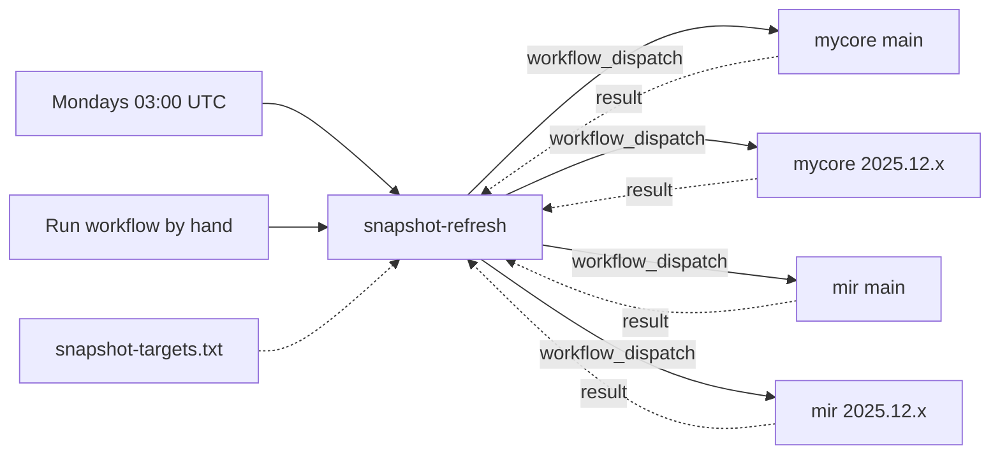

# snapshot-refresh.yml

Redeploys the snapshots of all projects and branches listed in [`snapshot-targets.txt`](../snapshot-targets.txt)
once a week, so they never expire. Unlike the other workflows it is not called by projects, it runs in this repository.

## Why

- Sonatype Central removes `-SNAPSHOT` versions after a while, currently after 90 days. Projects and version branches
  without pushes for that long would lose their snapshots, and builds of projects depending on them would fail.
  Projects that are not released, like most plugins, have nothing else on Central.
- A schedule in every project does not help. GitHub disables scheduled workflows in public repositories after
  60 days without activity, exactly in the quiet repositories that need the refresh. One schedule in this
  repository covers all of them.

## How it works



1. The workflow starts Mondays at 03:00 UTC (`cron: '0 3 * * 1'`) or by hand, and first enables itself again,
   see [Keeping the schedule enabled](#keeping-the-schedule-enabled).
2. It reads `snapshot-targets.txt` and starts the deploy workflow of every listed project on every listed branch,
   with the same checks and messages as [`dispatch-downstream.yml`](dispatch-downstream.md#how-it-works),
   except that a missing branch fails the run.
3. Every project deploys its snapshot with [`maven-deploy.yml`](maven-deploy.md). The upload is a new snapshot,
   so the 90 days start again.
4. The workflow waits until all started deploys have finished, at most 5 hours. It fails if one of them failed or
   did not finish in time, and its job summary lists every deploy with its result and a link to its log.
5. If the run failed, a message with the failing targets goes to Matrix, see [Monitoring](#monitoring).

Only one refresh runs at a time. A run started by hand while another one waits for its deploys starts afterwards.

GitHub runs scheduled workflows only from the default branch of the repository that contains them. That concerns
this workflow, which runs from `main` of this repository. It does not limit the targets: every line of
`snapshot-targets.txt` can name any branch of any project.

## Targets

`snapshot-targets.txt` has the format of the [dispatch targets](dispatch-downstream.md#targets).
Lines without a branch use the default branch of their repository, e.g. `master` for `easy-sword2-lib`.

```
# <owner/repository> <workflow> [<branch or pattern>]
MyCoRe-Org/mycore maven-snapshot.yml
MyCoRe-Org/mycore maven-snapshot.yml [0-9][0-9][0-9][0-9].[0-9][0-9].x
MyCoRe-Org/mir maven-snapshot.yml
MyCoRe-Org/mir maven-snapshot.yml [0-9][0-9][0-9][0-9].[0-9][0-9].x
MyCoRe-Org/<plugin> maven-snapshot.yml
```

- The pattern stands for all version branches that contain the deploy workflow. A new version branch is refreshed
  as soon as it exists, as it is created with the workflow. Old version branches without the workflow are skipped.
  To stop refreshing a version branch, delete its deploy workflow or the branch.
- Never use `*` alone, it would deploy feature branches as well, see [dispatch targets](dispatch-downstream.md#targets).
- Pushes and pull requests changing the file are checked by [`lint.yml`](lint.md): the format of every
  line, and that no line uses `*` alone.
- A project whose snapshot branch is not its default branch needs the branch in its line.
- A branch that does not exist, or a pattern that matches no branch with the deploy workflow, fails the run,
  otherwise the snapshots of that line would expire unnoticed. Add a pattern once a version branch has the workflow.
- All targets are started within seconds, their runs queue when the organization reaches its limit of
  concurrent jobs. The refresh takes as long as the slowest deploy.

## Adding a project

1. The deploy workflow of the project has the trigger `workflow_dispatch`, on the default branch and on every branch
   to refresh, see the [requirements for targets](dispatch-downstream.md#requirements-for-targets).
2. `DISPATCH_TOKEN` covers the repository, see [Token](dispatch-downstream.md#token).
3. Add the lines to `snapshot-targets.txt`.
4. Run the workflow by hand: Actions, "Snapshot Refresh", "Run workflow". Check its summary.

## Interplay with dispatch-downstream

The refresh starts every target directly. Projects that also dispatch their dependents after a deploy must restrict
that to pushes, as described in [One level deep](dispatch-downstream.md#one-level-deep), otherwise the dependents
build twice.

## Monitoring

- A deploy that fails makes the refresh fail, with its link in the annotations and in the job summary.
  Since the refresh runs weekly and a snapshot lasts 90 days, there are several weeks to fix a broken build
  before its snapshot expires.
- A failed refresh sends a message to the Matrix room of the [notifications](../README.md#notifications),
  with the link to the run and every failing target, so the whole team sees it.
- A deploy that was cancelled is only a warning. A push to the same branch during the refresh replaces the
  dispatched run within the concurrency group of the project, and that run deploys the snapshot as well.
- GitHub notifies the user who created the workflow about failed scheduled runs, or whoever changed the cron
  schedule or enabled the workflow last. Without the refresh's own failure, the failures of the deploys would only
  be reported to the account of `DISPATCH_TOKEN`.
- Scheduled runs can be delayed at high load, the start of every hour is such a time, and in rare cases they are
  dropped. With weekly runs and 90 days of retention a missed run does no harm.

## Keeping the schedule enabled

The 60 days rule applies to this repository as well. Every run therefore enables the workflow through the API,
which is reported to reset the 60 days. GitHub does not document that, so the step must not fail the refresh.
Merging the Dependabot updates keeps the repository active as well.

If the schedule gets disabled anyway, the snapshots still last 90 days from the last run. To switch it on again:
Actions, "Snapshot Refresh", "Enable workflow".

## Secrets

The workflow uses the organization secrets `DISPATCH_TOKEN` and `MATRIX_ACCESS_TOKEN` and the organization variables
`MATRIX_HOMESERVER` and `MATRIX_ROOM_ID`, which therefore have to be shared with this repository.
The requirements for `DISPATCH_TOKEN` are described in [Token](dispatch-downstream.md#token).
Enabling itself uses `GITHUB_TOKEN` with the permission `actions: write`.
